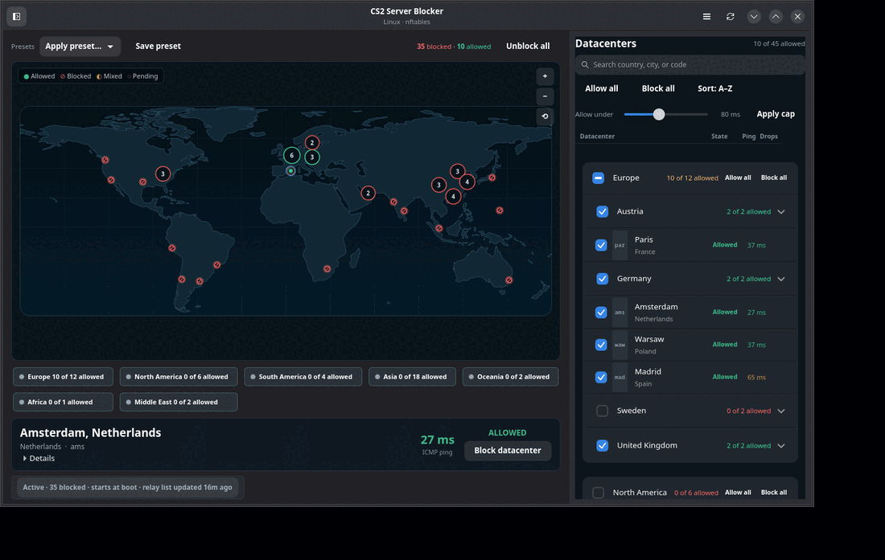

# CS2 Server Blocker for Linux

[](https://github.com/NasirA1991/cs2-server-blocker/actions/workflows/ci.yml)
[](https://github.com/NasirA1991/cs2-server-blocker/actions/workflows/aur.yml)
[](https://github.com/NasirA1991/cs2-server-blocker/releases/latest)
[](https://aur.archlinux.org/packages/cs2blocker)
[](LICENSE)

Take control of your CS2 matchmaking datacenters on Linux. CS2 Server Blocker
lets you choose which Steam Datagram Relay (SDR) datacenters the game can
reach, visualize them on an interactive world map, snapshot ICMP latency, and
apply the result directly through nftables.

- Interactive global datacenter map.
- Per-datacenter allowed/blocked state and a periodic ICMP latency snapshot.
- ICMP latency-cap bulk selection with a map preview.
- Presets and persistent firewall rules across reboots.
- Native nftables integration with an unprivileged GUI and a small helper.
- GTK4 GUI and a full CLI.



> **It is only a firewall rule manager.** It does not read, modify, inject into
> or even locate the game, its files, its memory or Steam. It does not touch
> `/etc/nftables.conf`, and it never runs `nft flush ruleset`. The only
> nftables object it owns is the table `inet cs2blocker`.

## Quick Start

**Arch Linux / CachyOS / Manjaro**

```bash
yay -S cs2blocker
# or: sudo pacman -U cs2blocker-0.2.0-1-any.pkg.tar.zst
```

**Debian / Ubuntu**

```bash
sudo apt install ./cs2blocker_0.2.0-1_amd64.deb
```

**Fedora / RHEL-compatible**

```bash
sudo dnf install ./cs2blocker-0.2.0-1.x86_64.rpm
```

**From the release tarball**

```bash
tar xzf cs2blocker-0.2.0.tar.gz
cd cs2blocker-0.2.0
sudo ./packaging/install.sh
```

Then enable persistence and open the app:

```bash
sudo systemctl enable --now cs2blocker.service
sudo systemctl enable --now cs2blocker-refresh.timer
cs2blocker-gui
```

See [Download](#download) for all release artifacts and dependencies.

---

## Features

- GUI (GTK4/libadwaita): an interactive world map with one dot per POP and a
  dense **Datacenters** sidebar. Blocked POPs are hollow red rings with a slash;
  allowed POPs are solid green dots; mixed clusters are neutral bubbles. Click a
  dot to block/allow it, click a cluster to open its POP list, drag to pan and
  scroll to zoom. Hover shows a compact callout. A compact inspector shows city,
  country, status, latency and drops, with relays/ports behind **Details**.
  The sidebar has search, collapsible continent sections, latency-cap bulk
  selection, sort by ping, continent and country bulk controls, and per-POP
  toggles. Pending map changes get dashed
  rings and a floating Apply/Revert bar. Region chips wrap and the right panel
  collapses automatically on narrow windows. Presets set the allowed/blocked
  state, and Apply commits it through the helper.
- CLI (`cs2blockctl`): `list`, `status`, `block`, `unblock`, `only`, `preset`,
  `refresh`, `apply`, `pause`, `resume`, `clear`, `ping`, `counters`, `doctor`.
- Explicit **Allowed / Blocked** state per datacenter. Checked means allowed.
- **Block newly added datacenters automatically** setting: when enabled, new
  Valve POPs start blocked after Apply; when disabled, they start allowed.
- **Allow all / Block all** bulk actions, with a confirmation before applying a
  state that leaves fewer than three datacenters allowed.
- UDP-only by default (the SDR relay port range, derived from Valve's data).
  ICMP keeps working, so map pings and the detail card remain useful while a
  POP is blocked.
- Persistent across reboots with systemd, and refreshed weekly from Valve.
- Root-owned SDR cache and config. The GUI never runs as root; privileged work
  goes through a small helper via a polkit action (`auth_admin_keep` for the
  active session, never for an inactive one) or `sudo` on systems without a
  polkit agent.
- Keyboard support for the map and datacenter rows; a status pill exposes
  backend, relay revision and boot state without cluttering the workspace.
- Follows the system light/dark preference; the map and surfaces have separate light and dark palettes. Requires libadwaita 1.5+ for `Adw.OverlaySplitView` and `Adw.AlertDialog`.
- Fail-safe: a failed fetch keeps the last good list; a failed apply leaves the
  previous table untouched because the whole ruleset is one `nft -f`
  transaction after an `nft -c` check.
- iptables/ipset fallback only when nftables is unavailable.
- Pause removes the rules while keeping the saved selection; resume restores
  exactly the same rules. `clear` remains the full reset that also forgets
  the selection.
- AppStream metadata, Bash/Zsh/Fish completions, SPDX SBOM and keyless cosign
  signatures for release checksums.
- Follows the desktop light/dark preference and uses native `Adw.AlertDialog`
  prompts instead of deprecated GTK dialogs.

---

## Requirements

- Linux with nftables (or iptables + ipset as a fallback).
- Python 3.11+.
- systemd for boot persistence and the weekly refresh (the helper/CLI/GUI still
  work without it; see [Non-systemd systems](#non-systemd-systems)).
- GTK4 + libadwaita 1.5+ + PyGObject for the GUI (the responsive split view and native alert dialogs use libadwaita 1.5).
- polkit (`pkexec`) and an authentication agent for GUI/CLI elevation. On
  minimal window managers without an agent, use the CLI with `sudo`.

### Install dependencies

**Arch / CachyOS / Manjaro**

```bash
sudo pacman -S --needed python nftables polkit python-gobject python-cairo gtk4 libadwaita
# optional fallback backend
sudo pacman -S --needed ipset
```

**Debian / Ubuntu**

```bash
sudo apt update
sudo apt install python3 nftables polkitd pkexec \
  python3-gi python3-cairo gir1.2-gtk-4.0 gir1.2-adw-1
# optional fallback backend
sudo apt install ipset
```

**Fedora**

```bash
sudo dnf install python3 nftables polkit python3-gobject python3-cairo gtk4 libadwaita
# optional fallback backend
sudo dnf install ipset
```

**openSUSE**

```bash
sudo zypper install python3 nftables polkit python3-gobject python3-cairo gtk4 libadwaita
# optional fallback backend
sudo zypper install ipset
```

Package names vary slightly by release. `nft --version`, `python3 -c 'import gi'`
and `pkexec --version` are the quick sanity checks.

---

## Install

### Arch: PKGBUILD

```bash
cd packaging
makepkg -si
```

The PKGBUILD builds from this git checkout (`git+file://$startdir`). For an AUR
upload, replace `source=` with the public git URL. The package installs files
but **does not enable or start anything**.

### Any distro: install script

```bash
sudo ./packaging/install.sh
```

This installs the helper, package, CLI, GUI, systemd units, polkit action,
desktop file, icon and man page under `/usr`. It does not enable units.

Then enable boot persistence explicitly:

```bash
sudo systemctl enable --now cs2blocker.service
sudo systemctl enable --now cs2blocker-refresh.timer
```

The GUI can toggle the same units from its **Settings** menu. The
monitor service is pulled in by `cs2blocker.service`; do not enable it
separately.

### Will it work on another distro?

It is not tied to `ufw`. The helper talks to nftables directly and owns only
the `inet cs2blocker` table. `ufw` and `firewalld` can stay enabled: their
normal reloads do not remove this table. If something explicitly runs
`nft flush ruleset`, re-apply with `sudo cs2blockctl apply`.

| System | Status |
| --- | --- |
| Arch / CachyOS / Manjaro | Native PKGBUILD and the generic installer; tested here. |
| Debian / Ubuntu / Fedora / openSUSE | Use the release `.deb`/`.rpm` or `packaging/install.sh` with the dependencies above. |
| Artix / Void / Alpine / non-systemd | Helper and CLI work; use an init script/cron. Boot persistence and the weekly timer require systemd; see [Non-systemd systems](#non-systemd-systems). |
| Windows / macOS | Not supported; this is a Linux netfilter tool. |

The only hard requirements are Linux with nftables (or `iptables` + `ipset` as
a fallback), Python 3.11+, and root only for apply/pause/resume/clear/refresh.
The GUI also needs GTK4, libadwaita, PyGObject and `python-cairo`. If no polkit agent is
running, the GUI prints the exact `sudo` fallback; the CLI works with
`sudo cs2blockctl ...`.

Run the built-in check on any machine:

```bash
cs2blockctl doctor
sudo cs2blockctl doctor   # also checks the kernel/backend
```

### Debian/RPM packages

`.deb` and `.rpm` packages are built by GitHub Actions with `nfpm` from the
same staged file list as `install.sh`; `postinst` runs `systemctl daemon-reload`
but does not enable the service. The Arch PKGBUILD and generic installer are
complete and tested to a staging root.

> **Why not Flatpak or AppImage?** A sandboxed app cannot install a root helper,
> a polkit action or systemd units, and cannot edit the host firewall. Shipping
> the privileged parts in Flatpak/AppImage would produce a GUI that cannot
> apply anything. Use the native package/script. An AppImage could only be a
> thin client for an already-installed helper, which is more confusing than
> useful.

---

## First use

GUI:

```bash
cs2blocker-gui
```

Click datacenter dots (or a region chip, or a row in the Datacenters panel), then
press **Apply**. The first Apply prompts through polkit. The map shows blocked
POPs as hollow red rings, allowed POPs as green dots, mixed clusters as amber
bubbles, and pending changes with dashed rings. Scroll to zoom, drag to pan and
use the map controls. Clicking a cluster opens its POP list rather than zooming.
Selecting a dot shows the inspector; technical relay/port data is under
**Details**.

The right-hand **Datacenters** panel groups POPs by continent and country.
Continents are collapsible; the region containing the selected datacenter opens
automatically. Use the search box for a country, city, or POP code. Country rows merge single-POP
countries into one row; multi-POP countries expand to city rows with code
badges. Sort by name or ping, hide zero-drop rows automatically, and use the
visible **Allow all / Block all** buttons per continent. Right-click a continent
header for **Block all except…**. The latency-cap slider previews matching dots
and **Apply cap** turns them into pending work. The map and sidebar stay in
sync.

Some cities have a Valve POP and a partner/Datapacket POP (for example `lhr`
and `dlhr` in London). They are separate entries because they use different
relay IPs; the map clusters them at the same city and the popover lists both.
Valve's partner feed sometimes publishes those coordinates as
`(latitude, longitude)` instead of `(longitude, latitude)`; the GUI normalizes
the pair against the other POPs in the same country before drawing it.

A single status pill shows whether rules are active, the applied blocked count,
boot persistence and relay-list age. Click it for backend, relay revision and the
firewall-table note. A relay-list change produces an in-app toast. Per-POP drop
counters update every two seconds while the monitor is running. The
**Settings** menu contains boot persistence and a manual refresh.

Use **Pause** in the top bar to remove the rules while keeping the current
selection; the map dims and the banner offers **Resume**. Pausing also stops the
counter monitor and survives a reboot until you resume. **Unblock all** is the
full reset and clears the saved selection.

CLI examples:

```bash
cs2blockctl list --region Europe
cs2blockctl ping --region Europe
cs2blockctl status
cs2blockctl counters --watch

sudo cs2blockctl block ams fra
sudo cs2blockctl only sto sto2
sudo cs2blockctl preset eu_only
sudo cs2blockctl preset --save "My EU set"
sudo cs2blockctl apply
sudo cs2blockctl refresh
sudo cs2blockctl pause        # temporary SDR switch-off
sudo cs2blockctl resume       # restore the paused selection
sudo cs2blockctl clear        # full reset: rules + saved selection
```

When the tool is installed, `cs2blockctl` uses `pkexec` automatically. If no
polkit agent is running, it prints the equivalent `sudo` command. Use
`cs2blockctl --sudo ...` to force sudo.

Presets live in `/etc/cs2blocker/config.json`. Built-ins (`EU only`,
`Block Asia + Oceania`, `Nordics`) are seeded on first use; the GUI and CLI can
save more. Applying a region preset expands it to the current explicit POP
codes, so a later relay refresh does not silently change an allow-only
selection.

---

## How it works

- Valve endpoint:
  `https://api.steampowered.com/ISteamApps/GetSDRConfig/v1/?appid=730`
- The helper fetches it over HTTPS, validates every POP code, address, port
  range and size limit, and atomically writes
  `/var/lib/cs2blocker/sdr-730.json` (root-owned, 0644).
- It generates one nftables table:

  ```nft
  table inet cs2blocker {
    set sdr_ports { ... }
    counter cnt_ams { ... }
    set pop_ams { ... }
    chain output {
      type filter hook output priority filter; policy accept;
      udp dport @sdr_ports ip daddr @pop_ams counter name cnt_ams drop
    }
  }
  ```

- It checks with `nft -c -f -`, then applies with a single `nft -f -`
  transaction that deletes/recreates **only** `inet cs2blocker`.
- `cs2blocker.service` applies the saved selection at boot, ordered after
  `network-pre.target` and after `nftables.service`/ufw/firewalld.
- `cs2blocker-refresh.timer` runs weekly (plus 15 minutes after boot, with a
  randomized delay), refreshes the list and re-applies.
- The GUI and CLI never need root for listing, pinging, status or counters.
- The map is drawn locally from public-domain Natural Earth 1:110m land data;
  it uses no online map tiles, tracking service or extra runtime dependency.
  `cs2blocker-monitor.service` publishes counters to
  `/run/cs2blocker/status.json`.

### Files

```
/usr/lib/cs2blocker/cs2blocker-helper   privileged helper (pkexec target)
/usr/lib/cs2blocker/cs2blocker/         Python package + bundled snapshot
/usr/bin/cs2blockctl                    CLI
/usr/bin/cs2blocker-gui                 GUI
/usr/lib/systemd/system/cs2blocker*.service|timer
/usr/share/polkit-1/actions/org.cs2blocker.policy

/etc/cs2blocker/config.json             selection + presets, root-owned 0644
/var/lib/cs2blocker/sdr-730.json        last good relay list
/var/lib/cs2blocker/state.json          last apply/refresh result
/run/cs2blocker/status.json             live counters (tmpfs)
```

---

## Why UDP-only?

SDR matchmaking and relay measurement are UDP. Dropping the SDR UDP port range
to a POP's relay IPs is enough to make that POP unusable, while leaving ICMP,
Steam downloads, voice and other Valve services alone. It also keeps the GUI
map ping/detail display meaningful: ICMP still replies while a POP is blocked.
ICMP RTT is only a rough proxy for the SDR UDP path; it is not SDR's own
latency measurement and some relays do not answer ICMP at all (shown as
`n/a`). The GUI refreshes the snapshot every 60 seconds using the median of
three probes. True SDR RTT is **not** implemented: Valve's SDR ping sampling
requires authenticated SteamNetworkingSockets/SDR ticket state, and replaying
a captured `sdping` packet to a relay does not produce a usable reply. The
latency shown in the app is therefore explicitly labelled ICMP, not SDR.

Release artifacts include an SPDX JSON SBOM and a keyless cosign signature for
`SHA256SUMS` (`.sig` and `.pem`). Verify with:

```bash
cosign verify-blob --certificate SHA256SUMS.pem --signature SHA256SUMS.sig SHA256SUMS
```

### Host-wide SDR side effects

The rule is installed in the host network namespace, not in CS2. Any other
program on the same machine that uses SDR (for example Dota 2, TF2, Deadlock,
or a Steam feature that rides SDR) is affected too. Per-process/cgroup scoping
is not implemented yet. Use `cs2blockctl pause` when you need SDR for another
game, and `cs2blockctl resume` afterwards.

A netfilter `drop` in the `output` hook makes the local `sendto()` return
`EPERM`. That is normal Linux behavior, and the game treats the relay as
unreachable. If you ever need to block all protocols, the helper supports
`--protocol all`; it is not the default because it is broader and makes the
map ping/detail display uninformative for blocked POPs.

---

## Boot persistence and refresh

```bash
systemctl status cs2blocker.service
systemctl restart cs2blocker.service     # re-apply; stays paused if paused
systemctl list-timers cs2blocker-refresh.timer
journalctl -u cs2blocker.service -u cs2blocker-refresh.service -b
```

The service is a oneshot with `RemainAfterExit=yes`, so `systemctl status`
shows active after a successful apply. It applies the saved selection with no
GUI, user session or network access. After `pause`, the boot service skips the
apply until you resume. `refresh` needs network and keeps the old cache/rules
if Valve is unavailable.

To disable persistence without removing the current rules:

```bash
sudo systemctl disable --now cs2blocker.service cs2blocker-refresh.timer
```

To temporarily remove the rules without losing the selection:

```bash
sudo cs2blockctl pause
sudo cs2blockctl resume
```

Pause keeps `config.json` untouched, removes the `inet cs2blocker` rules, and
stops the counter monitor. The boot service uses `apply --if-not-paused`, and
the weekly refresh also skips re-applying while paused, so a reboot does not
silently undo the pause. Resume re-applies the saved selection.

To remove the rules and clear the saved selection completely:

```bash
sudo cs2blockctl clear
```


---

## Non-systemd systems

Artix (OpenRC), Void (runit), Alpine (OpenRC) and similar systems can run the
same helper; only the unit/timer integration is missing. Install the files,
then call the helper after the network/firewall service.

**OpenRC example** (`/etc/init.d/cs2blocker`):

```sh
#!/sbin/openrc-run
description="CS2 Server Blocker firewall rules"
depend() {
    need net
    after nftables
}
start() {
    /usr/lib/cs2blocker/cs2blocker-helper apply --if-not-paused
}
stop() {
    /usr/lib/cs2blocker/cs2blocker-helper pause
}
```

```bash
sudo chmod +x /etc/init.d/cs2blocker
sudo rc-update add cs2blocker default
```

**runit:** call `/usr/lib/cs2blocker/cs2blocker-helper apply --if-not-paused`
from `/etc/rc.local` or a oneshot service; call `pause` to stop without losing
the saved selection. **Refresh:** run
`/usr/lib/cs2blocker/cs2blocker-helper refresh --timer` from cron/weekly
scheduler. The GUI's **Settings** menu persistence control and live monitor require
systemd; the CLI `apply`/`pause`/`resume`/`clear`/`refresh` still work.

---

## Troubleshooting

### Apply asks for a password and then says no agent

polkit needs an authentication agent. Install `polkit-kde-agent` (KDE),
`polkit-gnome` (GNOME), `lxpolkit` or `polkit-mate`, or run:

```bash
sudo cs2blockctl apply
sudo /usr/lib/cs2blocker/cs2blocker-helper apply
```

The GUI shows the exact sudo command when `pkexec` fails.

### `nft` not found / no kernel support

Install nftables. If the kernel genuinely lacks nf_tables, install `ipset` and
the helper will use the iptables fallback. Check:

```bash
cs2blockctl doctor
sudo cs2blockctl doctor
```

### Rules disappear after changing my firewall

Our table is separate. A manual `nft -f /etc/nftables.conf` that contains
`flush ruleset` will remove it; `cs2blockctl apply` restores it. `ufw reload`
and `firewalld --reload` do not touch `inet cs2blocker`. The iptables fallback
is less isolated: a ufw reload may remove its jump; re-apply or use nftables.

### CS2 still matches the region I blocked

- Check `cs2blockctl counters`: are the POP's counters increasing?
- Confirm the selection with `cs2blockctl status`.
- `refresh` after Valve changes relays.
- ICMP ping can look fine while SDR is blocked; counters are the proof.
- A VM/container running CS2 needs the optional `forward` chain; the GUI
  currently manages host traffic only.

### `PermissionError` / `EPERM`

Expected for UDP sent to a blocked relay. It is how local netfilter drops are
reported. It is not a tool error.

### Ping shows `n/a`

The unprivileged ICMP socket is restricted and the `ping` binary fallback is
not setuid/capable. The game's UDP measurements are unaffected.

---

## Remove everything

One command, including unblocking and removing config/cache:

```bash
sudo ./packaging/uninstall.sh --yes
```

Keep the saved config/cache:

```bash
sudo ./packaging/uninstall.sh --keep-config
```

Unblock only, keeping the tool installed:

```bash
sudo cs2blockctl clear
```

Manual leftovers, if any:

```bash
sudo systemctl disable --now cs2blocker.service cs2blocker-refresh.timer
sudo rm -rf /usr/lib/cs2blocker /etc/cs2blocker /var/lib/cs2blocker /run/cs2blocker
```

The uninstaller deletes only `inet cs2blocker`; it never flushes the ruleset.

---

## Builds and releases

Builds happen in GitHub Actions, not on the development machine.

- Every push to `master` runs tests and builds the Arch package, `.deb`, `.rpm`, source tarball and checksums. Download them from the **Actions** tab artifacts.
- Pushing a `v*` tag creates a GitHub release with all artifacts.
- The same tag also publishes the corresponding AUR package through the **AUR** workflow using the repository's `AUR_SSH_PRIVATE_KEY` secret.

A local checkout is for editing and testing only; release artifacts should come from CI.

## Development and tests

```bash
make test                                      # unprivileged unit tests + GUI smoke
make test-netns                                # root-in-userns end-to-end test
./cs2blocker-gui --smoke-test                  # GUI construction only
```

The netns test uses `unshare -rn`, creates its own table, verifies apply,
re-apply and clear, and checks that an unrelated nftables table survives. It
never modifies the host firewall.

Layout:

```
cs2blocker/core/        model, regions, SDR validation/cache, ruleset, backends
cs2blocker/helper.py    privileged helper
cs2blocker/cli.py       cs2blockctl
cs2blocker/gui/app.py        GTK4 window and actions
cs2blocker/gui/worldmap.py   Cairo world map, zoom/pan, dots and callouts
cs2blocker/gui/map_data.py   Natural Earth land rings (public domain)
cs2blocker/gui/locations.py  city/country labels from Valve POP descriptions
packaging/              install/uninstall, PKGBUILD, units, polkit, desktop, icon
tests/                  unit/integration tests and the ruleset snapshot
research/               Phase 0 evidence (not installed)
```

The design notes and Phase 0 findings are in [docs/design.md](docs/design.md)
and [docs/phase0-research.md](docs/phase0-research.md).

---

## Map data

The continent outlines are derived from Natural Earth 1:110m land data,
which is in the public domain (<https://www.naturalearthdata.com/about/terms-of-use/>).
The geometry is checked in and drawn locally; the app never requests map tiles.
No online map service is contacted.

## Download

Release artifacts:

| Format | Use |
| --- | --- |
| `.pkg.tar.zst` | Arch Linux, CachyOS, Manjaro |
| `.deb` | Debian, Ubuntu, Linux Mint |
| `.rpm` | Fedora, RHEL-compatible |
| `.tar.gz` | Any distro; run `packaging/install.sh` |
| AUR `cs2blocker` | `yay -S cs2blocker` |

[Download the latest release](https://github.com/NasirA1991/cs2-server-blocker/releases/latest).

AppImage and Flatpak are intentionally not provided: they cannot install the
root helper, polkit action and systemd units required to manage the host
firewall. See the packaging notes below for the reason.

## Roadmap

- [x] Interactive world map with per-datacenter state.
- [x] Latency-cap bulk selection with map preview.
- [x] Archived release artifacts and CI.
- [ ] Latency-based automatic selection as a first-class periodic mode.
- [ ] Optional latency trend history.
- [ ] Export/import presets.
- [ ] GUI-accessible diagnostics and recovery flow.
- [ ] Split the GUI window/state/services into smaller modules.
- [ ] Split CLI and GUI into separate packages (currently one package installs both).
- [ ] True SDR RTT probing; blocked on Valve's authenticated SteamNetworkingSockets/SDR ticket state.

## License

MIT. See [LICENSE](LICENSE). Not affiliated with Valve.
