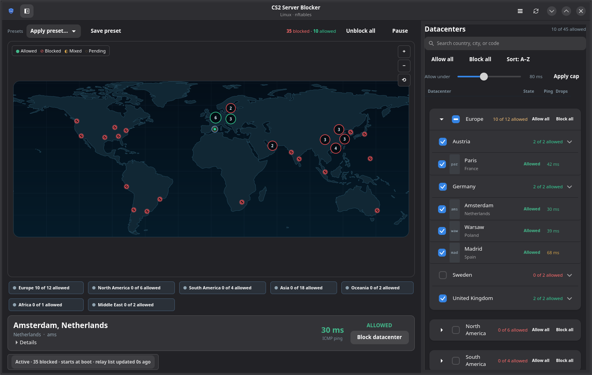
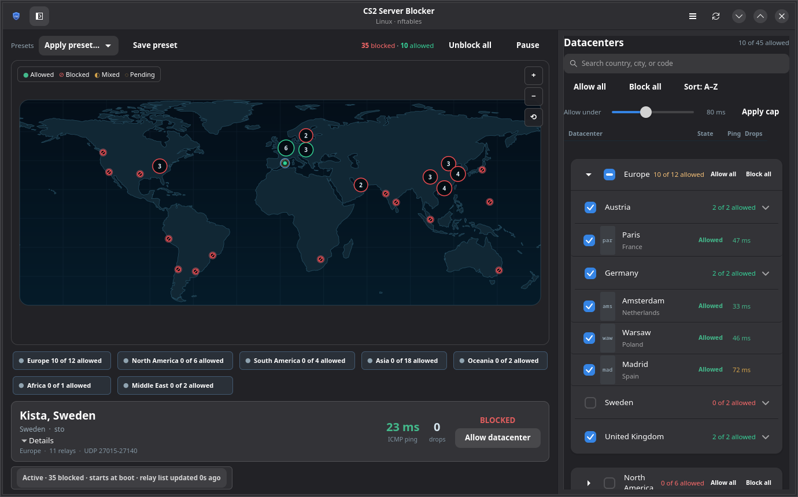
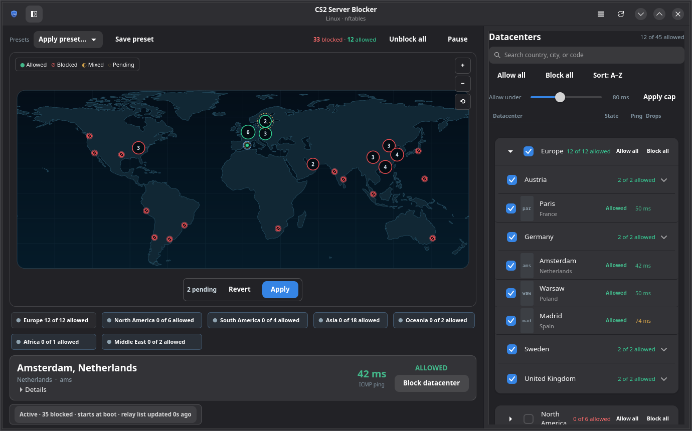

# CS2 Server Blocker for Linux

[](https://github.com/NasirA1991/cs2-server-blocker/actions/workflows/ci.yml)
[](https://github.com/NasirA1991/cs2-server-blocker/actions/workflows/aur.yml)
[](https://github.com/NasirA1991/cs2-server-blocker/releases/latest)
[](https://aur.archlinux.org/packages/cs2blocker)
[](LICENSE)

CS2 Server Blocker is a Linux firewall manager for choosing which
Counter-Strike 2 Steam Datagram Relay (SDR) datacenters the host can reach. It
shows Valve's relay network on an interactive world map, lets you allow or block
individual POPs, and applies the resulting UDP firewall rules through nftables
or an iptables/ipset fallback. It does not edit `/etc/nftables.conf` or flush
unrelated rules; the nftables backend touches only its own table.

> **Host-wide firewall warning**
>
> This application installs rules in the **host network namespace**. The rules
> are **not scoped to CS2**, a process, a cgroup, or a Steam account, and
> per-process/cgroup isolation is **not implemented**. Blocking an SDR POP can
> affect every local application that uses Steam Datagram Relay — including
> Dota 2, Team Fortress 2, Deadlock, and Steam features — not only CS2.
>
> `pause` removes the active rules temporarily while preserving the saved
> selection; `resume` reapplies that selection. The default UDP-only mode drops
> SDR relay traffic on the relay port range. It leaves ICMP, Steam downloads,
> and ordinary voice traffic alone. It is not a VPN: it does not hide your IP
> address or change your route.




| Datacenter inspector | Region selection and pending changes |
| --- | --- |
|  |  |

## What it does

### Interactive datacenter management

- A Cairo-rendered world map with one marker per POP that has relay endpoints.
  Click a marker to toggle it, click a cluster to inspect its POPs, scroll to
  zoom, drag to pan, or use the map controls.
- A searchable **Datacenters** sidebar grouped by continent and country, with
  collapsible sections, per-country and per-continent actions, and name/ping
  sorting.
- An inspector for the focused POP: city and country, Allowed/Blocked state,
  ICMP latency, drop count, relay count and UDP port range. **Details** reveals
  the region, relay count and ports.

### Region and bulk selection

- Region chips, built-in presets, **Allow all** / **Block all**, and a
  right-click **Block all except…** action.
- A latency-cap slider that previews which POPs would change. **Apply cap**
  turns the preview into pending edits; it does not commit them.
- Pending changes are never mixed with the applied state. The map uses distinct
  marker styles for allowed, blocked, mixed clusters and pending edits.

### Explicit firewall changes

- **Apply** is the only action that commits pending selection changes.
  **Revert** discards them.
- Default rules are **UDP-only** on the SDR relay port range. Blocking a POP does
  not block ICMP, so the latency readout remains available.
- **Pause** removes active rules but keeps the saved selection. **Resume**
  restores it. **Clear** (GUI: **Unblock all**) removes the rules and forgets the
  saved selection; presets remain.
- Boot persistence and weekly relay-list refresh are available through systemd.
  They are optional, and the application works without either.

### CLI and diagnostics

- `cs2blockctl` exposes selection, apply, pause/resume, presets, refresh, status,
  ping, counters and doctor checks for scripts and remote sessions.
- Per-POP nftables counters, live monitor output, machine-readable JSON and
  Bash/Zsh/Fish completions.
- Native GTK4/libadwaita dialogs, light/dark theme support, AppStream metadata,
  and a desktop launcher.

## Requirements

| Component | Requirement |
| --- | --- |
| System | Linux with nftables; iptables + ipset as fallback |
| Helper and CLI | Python 3.11 or newer |
| GUI | GTK4, libadwaita 1.5 or newer, PyGObject and `python-cairo` |
| Elevation | polkit with an authentication agent, or `sudo` |
| Persistence | systemd for boot persistence, the refresh timer and the monitor (optional) |

The GUI and CLI do not run as root. Firewall changes go through the installed
helper, elevated with polkit or `sudo`; the counter monitor is a separate
sandboxed root service.

## Install

All release artifacts are built by GitHub Actions and published on the
[latest release](https://github.com/NasirA1991/cs2-server-blocker/releases/latest):

| Distribution | Install |
| --- | --- |
| Arch Linux, CachyOS, Manjaro | `yay -S cs2blocker` (AUR), or `sudo pacman -U cs2blocker-*.pkg.tar.zst` |
| Debian, Ubuntu, Linux Mint | `sudo apt install ./cs2blocker_*_amd64.deb` |
| Fedora, RHEL-compatible | `sudo dnf install ./cs2blocker-*x86_64.rpm` |
| Other distributions | source tarball + `sudo ./packaging/install.sh` |

Packages are currently published for the architectures shown above: Debian
`amd64`, RPM `x86_64`, and an Arch `any` package. There is **no Flatpak or
AppImage** build: those sandboxes cannot install the root helper and polkit
action required to manage the host firewall.

Installing the package does **not** enable boot persistence or the weekly
refresh. To opt in:

```bash
sudo systemctl enable --now cs2blocker.service
sudo systemctl enable --now cs2blocker-refresh.timer
```

On a non-systemd system, use the source installer and the init-system guidance
in the [non-systemd guide](docs/NON_SYSTEMD.md). On a minimal window manager
without a polkit agent, use `sudo cs2blockctl apply`, or
`cs2blockctl --sudo apply`.

See the [installation guide](docs/INSTALLATION.md) for dependencies, release
verification, upgrades and removal.

## First use

1. Start `cs2blocker-gui`, then click a marker, a region chip, or a row in the
   **Datacenters** panel. The inspector shows the focused POP; use **Details**
   for relay information.
2. Make all desired edits. The pending bar shows how many changes are unsaved.
3. Press **Apply**. Authenticate through polkit when prompted.
4. To stop filtering temporarily, use **Pause**. Use **Resume** to restore the
   saved selection, or **Unblock all** (CLI: `clear`) to remove the rules and forget it.

A small CLI session:

```bash
cs2blockctl list --region Europe
cs2blockctl ping --region Europe
sudo cs2blockctl only sto sto2
sudo cs2blockctl pause
sudo cs2blockctl resume
```

`block` and `unblock` are mode-aware: they change the current selection without
silently converting an allow-list into a block-list. See the
[CLI reference](docs/CLI.md) for every command and option.

## Pause, resume and clear

| Operation | Active rules | Saved selection | Behavior across reboot |
| --- | --- | --- | --- |
| `pause` | removed | preserved | stays paused until `resume` |
| `resume` | restored from the saved selection | preserved | active rules return |
| `clear` | removed | forgotten | nothing is restored |

The systemd boot unit runs `apply --if-not-paused`; the refresh timer also
respects the paused state, so a paused machine does not silently start blocking
again after a reboot or relay refresh. Presets survive `clear`; the saved
selection does not.

## Latency: ICMP, not SDR

The latency shown in the GUI and by `cs2blockctl ping` is an **ICMP** round-trip
time from this machine. It is an indicative network measurement, not Valve's
SDR latency. CS2 uses SDR's own measurement and matchmaking process, so a good
ICMP result does not guarantee that the game selects that POP or sees the same
latency. Some POPs do not answer ICMP and show `n/a`.

The latency cap is based on these ICMP samples. True SDR RTT measurement is not
implemented; it would require Valve's authenticated SteamNetworkingSockets/SDR
state. See [latency and ping](docs/USAGE.md#latency-and-ping) and the
[firewall guide](docs/FIREWALL.md#host-wide-effects) for the limits.

## Safety model

- The nftables backend owns only `inet cs2blocker`; the iptables fallback owns
  its `CS2BLOCKER` chain, per-POP ipsets and its own `OUTPUT`/optional `FORWARD`
  jump. Neither backend edits `/etc/nftables.conf` or deletes unrelated rules.
- The nftables backend never runs `nft flush ruleset`. Its full ruleset is
  validated with `nft -c` and then applied as one transaction. A failed check
  leaves the previous rules in place. The iptables fallback builds a new chain
  and swaps the jump; it is best-effort atomic.
- The unprivileged GUI and CLI never modify rules directly. A short-lived root
  helper validates the request, and privileged operations are serialized.
- The helper validates Valve's relay document and keeps the last known-good
  cache. A failed refresh leaves the previous cache and rules usable.
- ICMP is not blocked by default. A local send to a blocked relay can still
  surface as `EPERM`; that is normal netfilter behaviour.

See [FIREWALL.md](docs/FIREWALL.md) for the complete rule and removal model and
[docs/design.md](docs/design.md) for the architecture and trust boundaries.

## Troubleshooting

Start with the built-in checks:

```bash
cs2blockctl doctor
sudo cs2blockctl doctor
cs2blockctl status
systemctl status cs2blocker.service
journalctl -u cs2blocker.service -u cs2blocker-refresh.service -b
```

Common causes and recovery steps are in the
[troubleshooting guide](docs/TROUBLESHOOTING.md).

## Uninstall

Use the package manager for a package install. For a source install, run
`sudo ./packaging/uninstall.sh --yes`; add `--keep-config` to keep the saved
selection and cache. Removal also clears this project's firewall objects.

`pause` is not uninstall: it removes the active rules but keeps the tool and selection.
See [Installation: removal](docs/INSTALLATION.md#removal) for manual cleanup and iptables fallback notes.

## Documentation

| Goal | Document |
| --- | --- |
| Install, upgrade or remove | [Installation](docs/INSTALLATION.md) |
| Use the GUI, understand selection and pause | [Usage](docs/USAGE.md) |
| Look up every command and option | [CLI reference](docs/CLI.md) |
| Understand rules, isolation and host-wide effects | [Firewall guide](docs/FIREWALL.md) |
| Fix authentication, firewall or GUI problems | [Troubleshooting](docs/TROUBLESHOOTING.md) |
| Run without systemd | [Non-systemd guide](docs/NON_SYSTEMD.md) |
| Build, test or release | [Development](docs/DEVELOPMENT.md) |
| Architecture and threat model | [Design](docs/design.md) |
| Original feasibility research | [Phase 0 research](docs/phase0-research.md) |
| Report a vulnerability | [Security policy](SECURITY.md) |

The [documentation index](docs/README.md) lists every document and the intended
audience.

## Builds and releases

Every push to `master` runs the tests, GUI smoke test, network-namespace
integration test, and package builds. A `v*` tag publishes a GitHub release with
an Arch package, `.deb`, `.rpm`, source tarball, SPDX SBOM, `SHA256SUMS`, and
keyless cosign signatures for the checksums. The AUR package is updated from the
same tag. Local package builds are for testing only; published artifacts come
from CI. See the [development guide](docs/DEVELOPMENT.md) for verification
commands and the release process.

## Map data

The map outlines are derived from Natural Earth 1:110m land data, which is in the
public domain ([Natural Earth terms](https://www.naturalearthdata.com/about/terms-of-use/)).
The geometry is checked into the repository and drawn locally; the application
does not request map tiles.

## Roadmap

Implemented:

- Interactive world map, clusters, inspector, search and continent/country
  grouping.
- Region and bulk selection, presets, latency-cap preview and pending/revert
  workflow.
- nftables backend with iptables/ipset fallback, UDP-only default, per-POP
  counters and single-transaction nftables updates.
- Pause/resume, systemd persistence, weekly refresh, CLI and JSON output.
- AppStream metadata, shell completions, SPDX SBOM and signed release checksums.

Planned:

- True SDR RTT probing. This is blocked on Valve authentication/SDR transport;
  replaying the captured `sdping` packet did not produce replies.
- Split the GUI window/state/services into smaller modules.
- Split the CLI and GUI into separate packages.
- Periodic latency-based selection and latency trend history.
- Preset import/export.

## License

MIT. See [LICENSE](LICENSE). Not affiliated with Valve.
