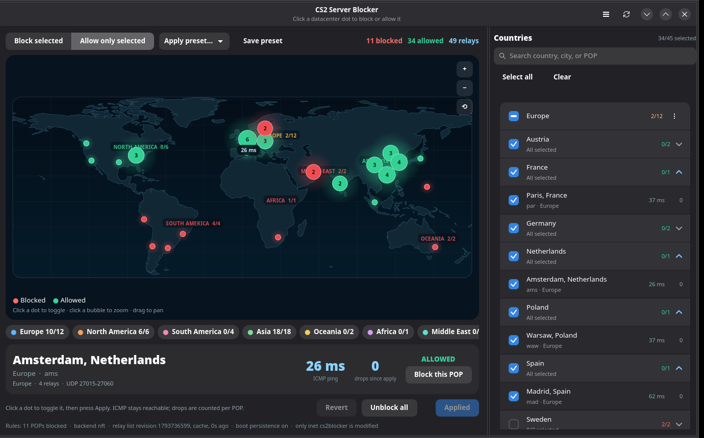
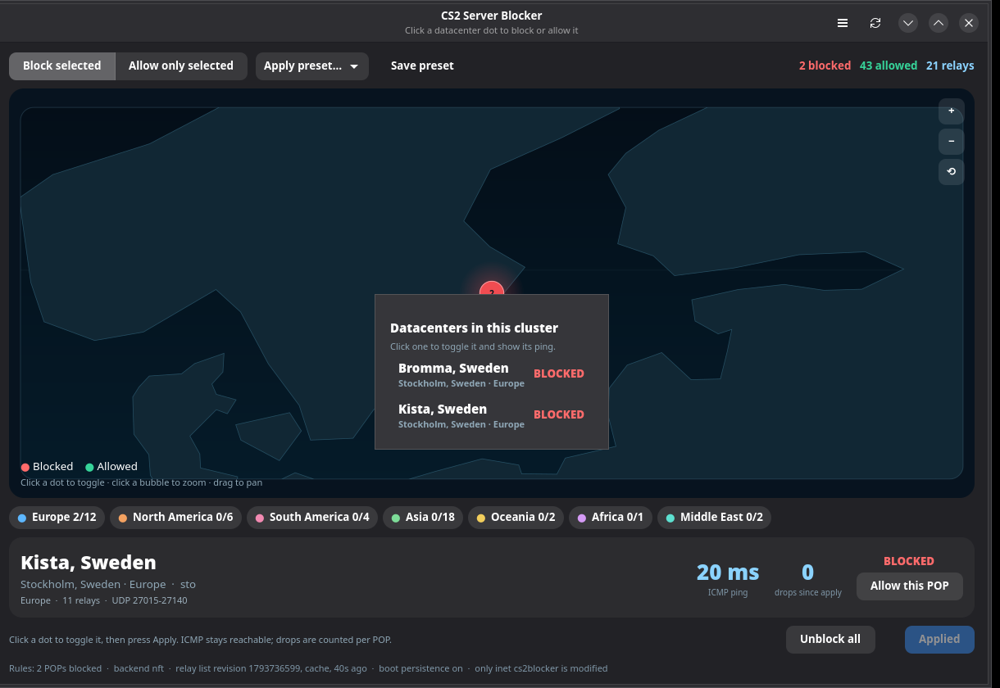

# CS2 Server Blocker for Linux

Block CS2 matchmaking datacenters at the host firewall, with a GUI, a CLI, and
rules that survive reboots. Native Steam and Flatpak Steam are equivalent,
because the block happens in the kernel's network stack.

> **It is only a firewall rule manager.** It does not read, modify, inject into
> or even locate the game, its files, its memory or Steam. It does not touch
> `/etc/nftables.conf`, and it never runs `nft flush ruleset`. The only
> nftables object it owns is the table `inet cs2blocker`.

CS2 uses Valve's Steam Datagram Relay (SDR). The client measures POPs and picks
one; blocking the relay IPs of a POP makes that POP unattractive. This tool
fetches Valve's SDR config for appid 730, validates it, and installs a small
nftables table with one named set and one named counter per blocked POP.



Clicking a crowded cluster opens the individual cities, each with its own
state and ping:



---

## Features

- GUI (GTK4/libadwaita): an interactive world map with one dot per POP and a
  **Countries** sidebar. Click a dot to block/allow it, click a cluster to zoom
  in or list its cities, drag to pan and scroll to zoom. A detail card shows
  city, country, region, relay/port data, live ICMP ping and per-POP drop
  counters. The sidebar has search, continent/country checkboxes, per-country
  server expansion, and an **All except…** action per continent. Region chips
  also toggle a whole region. Presets load a selection, and Apply commits it
  through the helper.
- CLI (`cs2blockctl`): `list`, `status`, `block`, `unblock`, `only`, `preset`,
  `refresh`, `apply`, `clear`, `ping`, `counters`, `doctor`.
- Two modes:
  - **Block selected**: block only the selected POPs.
  - **Allow only selected**: block every other known POP; a newly announced POP
    is blocked by default after a refresh.
- UDP-only by default (the SDR relay port range, derived from Valve's data).
  ICMP keeps working, so map pings and the detail card remain useful while a
  POP is blocked.
- Persistent across reboots with systemd, and refreshed weekly from Valve.
- Root-owned SDR cache and config. The GUI never runs as root; privileged work
  goes through a small helper via a polkit action (`auth_admin_keep`) or
  `sudo` on systems without a polkit agent.
- Fail-safe: a failed fetch keeps the last good list; a failed apply leaves the
  previous table untouched because the whole ruleset is one `nft -f`
  transaction after an `nft -c` check.
- iptables/ipset fallback only when nftables is unavailable.
- One-command unblock and one-command full removal.

---

## Requirements

- Linux with nftables (or iptables + ipset as a fallback).
- Python 3.11+.
- systemd for boot persistence and the weekly refresh (the helper/CLI/GUI still
  work without it; see [Non-systemd systems](#non-systemd-systems)).
- GTK4 + libadwaita + PyGObject for the GUI.
- polkit (`pkexec`) and an authentication agent for GUI/CLI elevation. On
  minimal window managers without an agent, use the CLI with `sudo`.

### Install dependencies

**Arch / CachyOS / Manjaro**

```bash
sudo pacman -S --needed python nftables polkit python-gobject python-cairo gtk4 libadwaita
# optional fallback backend
sudo pacman -S --needed ipset
```

**Debian / Ubuntu**

```bash
sudo apt update
sudo apt install python3 nftables polkitd pkexec \
  python3-gi python3-cairo gir1.2-gtk-4.0 gir1.2-adw-1
# optional fallback backend
sudo apt install ipset
```

**Fedora**

```bash
sudo dnf install python3 nftables polkit python3-gobject python3-cairo gtk4 libadwaita
# optional fallback backend
sudo dnf install ipset
```

**openSUSE**

```bash
sudo zypper install python3 nftables polkit python3-gobject python3-cairo gtk4 libadwaita
# optional fallback backend
sudo zypper install ipset
```

Package names vary slightly by release. `nft --version`, `python3 -c 'import gi'`
and `pkexec --version` are the quick sanity checks.

---

## Install

### Arch: PKGBUILD

```bash
cd packaging
makepkg -si
```

The PKGBUILD builds from this git checkout (`git+file://$startdir`). For an AUR
upload, replace `source=` with the public git URL. The package installs files
but **does not enable or start anything**.

### Any distro: install script

```bash
sudo ./packaging/install.sh
```

This installs the helper, package, CLI, GUI, systemd units, polkit action,
desktop file, icon and man page under `/usr`. It does not enable units.

Then enable boot persistence explicitly:

```bash
sudo systemctl enable --now cs2blocker.service
sudo systemctl enable --now cs2blocker-refresh.timer
```

The GUI can toggle the same units from its **Settings** menu. The
monitor service is pulled in by `cs2blocker.service`; do not enable it
separately.

### Will it work on another distro?

It is not tied to `ufw`. The helper talks to nftables directly and owns only
the `inet cs2blocker` table. `ufw` and `firewalld` can stay enabled: their
normal reloads do not remove this table. If something explicitly runs
`nft flush ruleset`, re-apply with `sudo cs2blockctl apply`.

| System | Status |
| --- | --- |
| Arch / CachyOS / Manjaro | Native PKGBUILD and the generic installer; tested here. |
| Debian / Ubuntu / Fedora / openSUSE | Use `packaging/install.sh` and install the dependencies listed above. `.deb`/`.rpm` files are not built yet. |
| Artix / Void / Alpine / non-systemd | Helper and CLI work; use an init script/cron. Boot persistence and the weekly timer require systemd; see [Non-systemd systems](#non-systemd-systems). |
| Windows / macOS | Not supported; this is a Linux netfilter tool. |

The only hard requirements are Linux with nftables (or `iptables` + `ipset` as
a fallback), Python 3.11+, and root only for apply/clear/refresh. The GUI also
needs GTK4, libadwaita, PyGObject and `python-cairo`. If no polkit agent is
running, the GUI prints the exact `sudo` fallback; the CLI works with
`sudo cs2blockctl ...`.

Run the built-in check on any machine:

```bash
cs2blockctl doctor
sudo cs2blockctl doctor   # also checks the kernel/backend
```

### Debian/RPM packages

`.deb` and `.rpm` packages are not built in this pass. The planned path is
`nfpm` using the same file list as `install.sh` (package, helper, units, polkit
action, desktop file, icon, man page), with `postinst` running `systemctl
daemon-reload` but not enabling the service. The Arch PKGBUILD and generic
installer are complete and tested to a staging root.

> **Why not Flatpak or AppImage?** A sandboxed app cannot install a root helper,
> a polkit action or systemd units, and cannot edit the host firewall. Shipping
> the privileged parts in Flatpak/AppImage would produce a GUI that cannot
> apply anything. Use the native package/script. An AppImage could only be a
> thin client for an already-installed helper, which is more confusing than
> useful.

---

## First use

GUI:

```bash
cs2blocker-gui
```

Pick a mode, click datacenter dots (or a region chip, or a country in the
sidebar), then press **Apply**. The first Apply prompts through polkit. The map
shows blocked POPs in red and allowed POPs in green; **Allow only selected**
inverts that meaning. Scroll to zoom, drag to pan, and click a counted cluster
to zoom into that area. Hovering a dot shows its city/country; clicking it opens
the detail card with ping, relay count, ports and drops.

The right-hand **Countries** panel groups POPs by continent and country. Use the
search box for a country, city, or POP code. Click a country's checkbox to
toggle every server in it, expand the row to control individual servers, or use
the continent's **⋮** menu to select every POP except one country. The map and
sidebar stay in sync.

The status banner shows whether rules are active, where the relay list came
from, and whether boot persistence is enabled. Per-POP drop counters update
every two seconds while the monitor is running. The **Settings** menu contains
boot persistence and a manual refresh.

CLI examples:

```bash
cs2blockctl list --region Europe
cs2blockctl ping --region Europe
cs2blockctl status
cs2blockctl counters --watch

sudo cs2blockctl block ams fra
sudo cs2blockctl only sto sto2
sudo cs2blockctl preset eu_only
sudo cs2blockctl preset --save "My EU set"
sudo cs2blockctl apply
sudo cs2blockctl refresh
sudo cs2blockctl clear        # one-command unblock
```

When the tool is installed, `cs2blockctl` uses `pkexec` automatically. If no
polkit agent is running, it prints the equivalent `sudo` command. Use
`cs2blockctl --sudo ...` to force sudo.

Presets live in `/etc/cs2blocker/config.json`. Built-ins (`EU only`,
`Block Asia + Oceania`, `Nordics`) are seeded on first use; the GUI and CLI can
save more. Applying a region preset expands it to the current explicit POP
codes, so a later relay refresh does not silently change an allow-only
selection.

---

## How it works

- Valve endpoint:
  `https://api.steampowered.com/ISteamApps/GetSDRConfig/v1/?appid=730`
- The helper fetches it over HTTPS, validates every POP code, address, port
  range and size limit, and atomically writes
  `/var/lib/cs2blocker/sdr-730.json` (root-owned, 0644).
- It generates one nftables table:

  ```nft
  table inet cs2blocker {
    set sdr_ports { ... }
    counter cnt_ams { ... }
    set pop_ams { ... }
    chain output {
      type filter hook output priority filter; policy accept;
      udp dport @sdr_ports ip daddr @pop_ams counter name cnt_ams drop
    }
  }
  ```

- It checks with `nft -c -f -`, then applies with a single `nft -f -`
  transaction that deletes/recreates **only** `inet cs2blocker`.
- `cs2blocker.service` applies the saved selection at boot, ordered after
  `network-pre.target` and after `nftables.service`/ufw/firewalld.
- `cs2blocker-refresh.timer` runs weekly (plus 15 minutes after boot, with a
  randomized delay), refreshes the list and re-applies.
- The GUI and CLI never need root for listing, pinging, status or counters.
- The map is drawn locally from public-domain Natural Earth 1:110m land data;
  it uses no online map tiles, tracking service or extra runtime dependency.
  `cs2blocker-monitor.service` publishes counters to
  `/run/cs2blocker/status.json`.

### Files

```
/usr/lib/cs2blocker/cs2blocker-helper   privileged helper (pkexec target)
/usr/lib/cs2blocker/cs2blocker/         Python package + bundled snapshot
/usr/bin/cs2blockctl                    CLI
/usr/bin/cs2blocker-gui                 GUI
/usr/lib/systemd/system/cs2blocker*.service|timer
/usr/share/polkit-1/actions/org.cs2blocker.policy

/etc/cs2blocker/config.json             selection + presets, root-owned 0644
/var/lib/cs2blocker/sdr-730.json        last good relay list
/var/lib/cs2blocker/state.json          last apply/refresh result
/run/cs2blocker/status.json             live counters (tmpfs)
```

---

## Why UDP-only?

SDR matchmaking and relay measurement are UDP. Dropping the SDR UDP port range
to a POP's relay IPs is enough to make that POP unusable, while leaving ICMP,
Steam downloads, voice and other Valve services alone. It also keeps the GUI
map ping/detail display meaningful: ICMP still replies while a POP is blocked.

A netfilter `drop` in the `output` hook makes the local `sendto()` return
`EPERM`. That is normal Linux behavior, and the game treats the relay as
unreachable. If you ever need to block all protocols, the helper supports
`--protocol all`; it is not the default because it is broader and makes the
map ping/detail display uninformative for blocked POPs.

---

## Boot persistence and refresh

```bash
systemctl status cs2blocker.service
systemctl restart cs2blocker.service     # re-apply / reboot simulation
systemctl list-timers cs2blocker-refresh.timer
journalctl -u cs2blocker.service -u cs2blocker-refresh.service -b
```

The service is a oneshot with `RemainAfterExit=yes`, so `systemctl status`
shows active after a successful apply. It applies the saved selection with no
GUI, user session or network access. `refresh` needs network and keeps the old
cache/rules if Valve is unavailable.

To disable persistence without removing the current rules:

```bash
sudo systemctl disable --now cs2blocker.service cs2blocker-refresh.timer
```

To remove the rules now:

```bash
sudo cs2blockctl clear
```

---

## Non-systemd systems

Artix (OpenRC), Void (runit), Alpine (OpenRC) and similar systems can run the
same helper; only the unit/timer integration is missing. Install the files,
then call the helper after the network/firewall service.

**OpenRC example** (`/etc/init.d/cs2blocker`):

```sh
#!/sbin/openrc-run
description="CS2 Server Blocker firewall rules"
depend() {
    need net
    after nftables
}
start() {
    /usr/lib/cs2blocker/cs2blocker-helper apply
}
stop() {
    /usr/lib/cs2blocker/cs2blocker-helper clear
}
```

```bash
sudo chmod +x /etc/init.d/cs2blocker
sudo rc-update add cs2blocker default
```

**runit:** call `/usr/lib/cs2blocker/cs2blocker-helper apply` from
`/etc/rc.local` or a oneshot service. **Refresh:** run
`/usr/lib/cs2blocker/cs2blocker-helper refresh --timer` from cron/weekly
scheduler. The GUI's **Settings** menu persistence control and live monitor require
systemd; the CLI `apply`/`clear`/`refresh` still work.

---

## Troubleshooting

### Apply asks for a password and then says no agent

polkit needs an authentication agent. Install `polkit-kde-agent` (KDE),
`polkit-gnome` (GNOME), `lxpolkit` or `polkit-mate`, or run:

```bash
sudo cs2blockctl apply
sudo /usr/lib/cs2blocker/cs2blocker-helper apply
```

The GUI shows the exact sudo command when `pkexec` fails.

### `nft` not found / no kernel support

Install nftables. If the kernel genuinely lacks nf_tables, install `ipset` and
the helper will use the iptables fallback. Check:

```bash
cs2blockctl doctor
sudo cs2blockctl doctor
```

### Rules disappear after changing my firewall

Our table is separate. A manual `nft -f /etc/nftables.conf` that contains
`flush ruleset` will remove it; `cs2blockctl apply` restores it. `ufw reload`
and `firewalld --reload` do not touch `inet cs2blocker`. The iptables fallback
is less isolated: a ufw reload may remove its jump; re-apply or use nftables.

### CS2 still matches the region I blocked

- Check `cs2blockctl counters`: are the POP's counters increasing?
- Confirm the selection with `cs2blockctl status`.
- `refresh` after Valve changes relays.
- ICMP ping can look fine while SDR is blocked; counters are the proof.
- A VM/container running CS2 needs the optional `forward` chain; the GUI
  currently manages host traffic only.

### `PermissionError` / `EPERM`

Expected for UDP sent to a blocked relay. It is how local netfilter drops are
reported. It is not a tool error.

### Ping shows `n/a`

The unprivileged ICMP socket is restricted and the `ping` binary fallback is
not setuid/capable. The game's UDP measurements are unaffected.

---

## Remove everything

One command, including unblocking and removing config/cache:

```bash
sudo ./packaging/uninstall.sh --yes
```

Keep the saved config/cache:

```bash
sudo ./packaging/uninstall.sh --keep-config
```

Unblock only, keeping the tool installed:

```bash
sudo cs2blockctl clear
```

Manual leftovers, if any:

```bash
sudo systemctl disable --now cs2blocker.service cs2blocker-refresh.timer
sudo rm -rf /usr/lib/cs2blocker /etc/cs2blocker /var/lib/cs2blocker /run/cs2blocker
```

The uninstaller deletes only `inet cs2blocker`; it never flushes the ruleset.

---

## Development and tests

```bash
make test                                      # unprivileged unit tests + GUI smoke
make test-netns                                # root-in-userns end-to-end test
./cs2blocker-gui --smoke-test                  # GUI construction only
```

The netns test uses `unshare -rn`, creates its own table, verifies apply,
re-apply and clear, and checks that an unrelated nftables table survives. It
never modifies the host firewall.

Layout:

```
cs2blocker/core/        model, regions, SDR validation/cache, ruleset, backends
cs2blocker/helper.py    privileged helper
cs2blocker/cli.py       cs2blockctl
cs2blocker/gui/app.py        GTK4 window and actions
cs2blocker/gui/worldmap.py   Cairo world map, zoom/pan, dots and callouts
cs2blocker/gui/map_data.py   Natural Earth land rings (public domain)
cs2blocker/gui/locations.py  city/country labels from Valve POP descriptions
packaging/              install/uninstall, PKGBUILD, units, polkit, desktop, icon
tests/                  unit/integration tests and the ruleset snapshot
research/               Phase 0 evidence (not installed)
```

The design notes and Phase 0 findings are in [docs/design.md](docs/design.md)
and [docs/phase0-research.md](docs/phase0-research.md).

---

## Map data

The continent outlines are derived from Natural Earth 1:110m land data,
which is in the public domain (<https://www.naturalearthdata.com/about/terms-of-use/>).
The geometry is checked in and drawn locally; the app never requests map tiles.
No online map service is contacted.

## License

MIT. See [LICENSE](LICENSE). Not affiliated with Valve.
