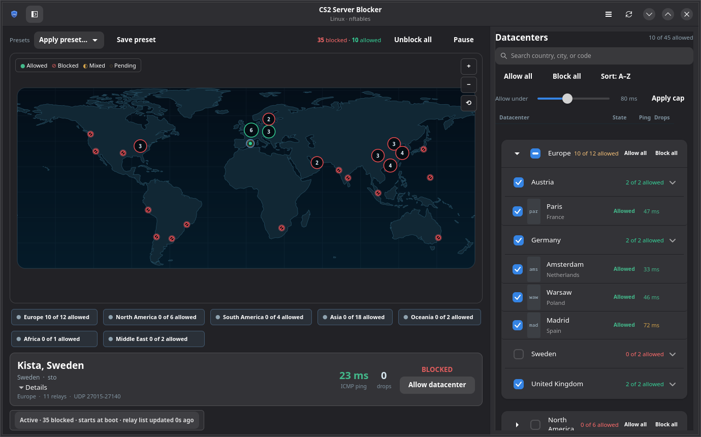
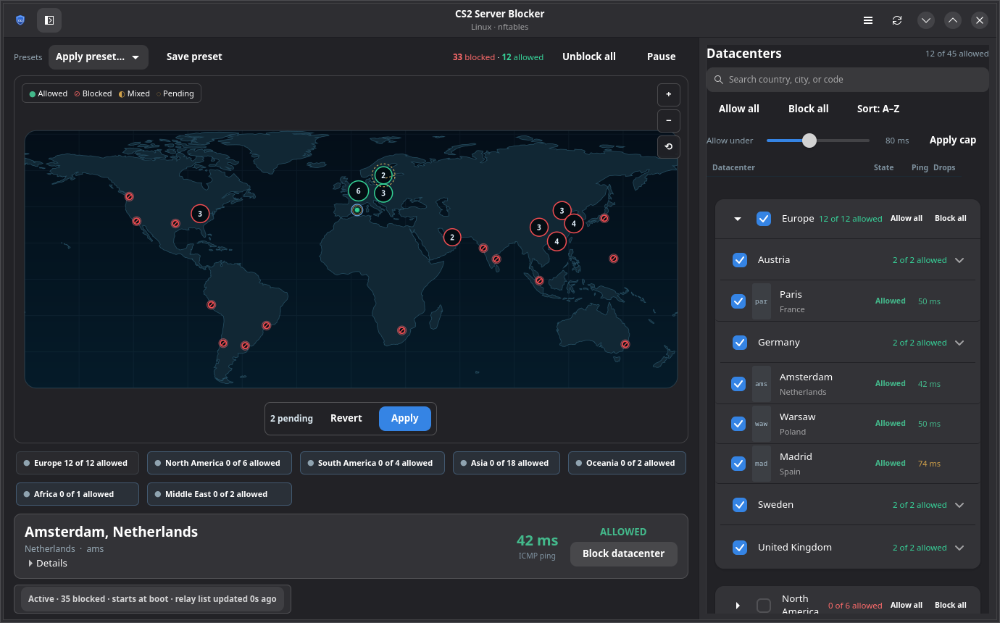

# Usage

This guide covers the GUI, the selection model, pause/resume, presets, and the
state stored on disk. For the complete command reference, see
[CLI.md](CLI.md). For installation, see [INSTALLATION.md](INSTALLATION.md).

> **The firewall is host-wide.** The rules are not scoped to CS2 or to a single
> process. Read the [host-wide effects](FIREWALL.md#host-wide-effects) before
> applying a small allow-list. The short version: other SDR applications on the
> same machine can be affected, and `pause` is the temporary off switch that
> keeps your selection.

## The selection model

Every POP is either **Allowed** or **Blocked**. The GUI keeps the applied state
separate from the pending state:

- Editing a marker, row or region chip changes the pending selection. It does
  not touch the firewall yet.
- **Apply** commits the pending selection through the privileged helper.
- **Revert** discards pending edits and returns to the applied state.
- **Pause** removes active rules but preserves the saved selection.
  **Resume** reapplies that selection.
- **Clear** (GUI: **Unblock all**) removes the rules and forgets the saved
  selection, but keeps presets.

The GUI does not expose a raw block-list/allow-list switch. The
**Block newly added datacenters automatically** setting controls what happens
when a later Valve snapshot adds a POP:

- **Off (default):** new POPs start allowed; the saved selection stores the
  blocked POPs (`block` mode internally).
- **On:** new POPs start blocked; the saved selection stores the allowed POPs
  (`only` mode internally). Any POP not explicitly allowed is blocked.

Changing the setting converts the visible selection to the equivalent
allowed/blocked state and creates a pending change. It does not apply anything
until you press **Apply**.

## First run

```bash
cs2blocker-gui
```

At start the map uses the last applied selection. Panels and markers are
interactive immediately, but nothing changes on the firewall until **Apply**.
The first privileged action asks for authentication through polkit. If no
polkit agent is available, the error shows the exact `sudo` fallback.

## GUI

### Map

- Click a marker to toggle that POP between Allowed and Blocked.
- Click a cluster bubble to open a list of the POPs it contains.
- Drag to pan and scroll to zoom. The `+`, `−` and reset buttons are at the
  top-right of the map.
- Click a region chip below the map to toggle every POP in that SDR region.
- Hover for a compact callout. Selecting a POP updates the inspector.

Marker appearance reflects both applied and pending state. Allowed POPs are
solid, blocked POPs are hollow with a slash, mixed clusters use a neutral
bubble, and pending edits use dashed rings. While edits are pending, a bar over
the map shows the change count, **Revert** and **Apply**.

### Datacenters panel

The right-hand panel groups POPs by continent and country.

- Search by city, country or POP code.
- Expand or collapse continents with the chevron.
- Country rows show how many POPs are allowed. Single-POP countries appear as
  one row; countries with several POPs expand to city rows with code badges.
- Use **Allow all** / **Block all** on a continent or country row for bulk
  edits. Right-click a continent header for **Block all except…**.
- Sort by name or ping. The latency cap previews a bulk edit; **Apply cap**
  turns that preview into pending changes only.

### Inspector and status

The inspector shows the focused POP's city and country, Allowed/Blocked state,
ICMP latency, drops since the last apply, relay count and UDP port range.
**Details** reveals the SDR region and port summary.



The status pill reports whether rules are active, the backend, the relay-list
revision and cache age. The **Settings** menu contains manual refresh, boot
persistence, the new-datacenter policy, and **Undo last apply**.

Per-POP counters update every two seconds while the monitor service is running.
The GUI refreshes ICMP samples in the background; see
[latency and ping](#latency-and-ping).

### Pause, resume and reset

| Action | What happens |
| --- | --- |
| **Pause** | Removes the nftables table or iptables chain, stops the monitor, keeps the saved selection, and marks the state paused. The map dims and the banner offers **Resume**. |
| **Resume** | Reapplies the saved selection exactly. If application fails, the state remains paused. |
| **Unblock all** / `clear` | Removes the rules and forgets the saved selection. Presets remain. |

Pause is persistent: the boot unit uses `apply --if-not-paused`, and the refresh
path skips re-applying while paused. A reboot does not silently restart
blocking. Press **Resume** (or run `sudo cs2blockctl resume`) when you want the
rules back.

If there are unsaved pending edits, the GUI refuses to pause until you apply or
discard them, so the stored selection is not ambiguous.

Pause is the right tool when another game needs SDR. Clear is the full reset;
it is not a temporary pause.

## Region and pending edits



A region chip toggles all POPs in that region. The screenshot above shows the
state after a region edit: Europe is fully allowed in the pending selection,
the map and sidebar reflect the pending state, and the bar offers **Apply** or
**Revert**. Nothing has been written to the firewall yet.

The same pending workflow applies to a single marker, a country row, a preset,
or the latency-cap preview.

## Presets

Presets are stored in `/etc/cs2blocker/config.json`. Built-in presets are seeded
on first use:

| Preset | Selection |
| --- | --- |
| `EU only` | Allow only Europe |
| `Block Asia + Oceania` | Block Asia and Oceania |
| `Nordics` | Allow only `sto` and `sto2` |

`cs2blockctl preset --list` prints the presets. `preset --save NAME` saves the
current selection; `preset --delete NAME` removes a user preset. Applying a
regional preset resolves it against the current snapshot and stores explicit
POP codes, so a later relay refresh does not silently change an allow-only
selection.

See [CLI.md](CLI.md#presets) for the command forms.

## Boot persistence and refresh

The packages install units but do not enable them. To keep the selection active
after a reboot and refresh Valve's relay list weekly:

```bash
sudo systemctl enable --now cs2blocker.service
sudo systemctl enable --now cs2blocker-refresh.timer
```

The monitor service is pulled in by `cs2blocker.service`; do not enable it
separately. The timer runs shortly after boot and weekly thereafter, with a
randomized delay. A failed refresh keeps the last known-good cache and rules.

Persistence can also be toggled from **Settings**. Without systemd, see
[NON_SYSTEMD.md](NON_SYSTEMD.md).

## Latency and ping

The latency shown in the GUI and by `cs2blockctl ping` is an **ICMP** round-trip
time from this machine. It is not Valve's SDR latency, and not the value CS2 uses
for matchmaking.

- The GUI runs ICMP probes in the background and shows an indicative sample;
  the CLI performs its own ICMP probes.
- Some POPs do not answer ICMP and show `n/a`. This does not mean the game is
  blocked or unreachable over UDP.
- A good ICMP result does not guarantee that CS2 will select that POP or
  experience the same in-game latency.
- The latency cap is based on the available ICMP samples, not on an SDR
  measurement.
- Blocking a POP in UDP-only mode leaves ICMP reachable, so a blocked POP can
  still answer ping. A successful ping is not proof that the rule is missing.

True SDR RTT measurement is not implemented. It would require Valve's
authenticated SteamNetworkingSockets/SDR transport rather than a plain UDP echo.

## Status and counters

- `cs2blockctl status` reports the saved selection, active rules, cache age and
  boot persistence.
- `cs2blockctl counters` reads the monitor's published snapshot. If the monitor
  is not running or the table is inactive, there are no live counters.
- Counters show drops since the last apply. Pausing stops the monitor; the last
  values remain until rules are resumed.
- `cs2blockctl doctor` checks the backend, nftables, polkit, units and common
  firewall conflicts. `sudo cs2blockctl doctor` or `doctor --privileged` adds
  checks that need root.

## Configuration and files

The helper owns these files; the GUI and CLI are the supported way to change
them.

| Path | Purpose |
| --- | --- |
| `/etc/cs2blocker/config.json` | Selection, policy and presets; root-owned, written by the helper |
| `/var/lib/cs2blocker/sdr-730.json` | Last validated Valve relay list |
| `/var/lib/cs2blocker/state.json` | Last apply/refresh result and pause state |
| `/run/cs2blocker/status.json` | Live counters and backend status |
| `/run/cs2blocker/lock` | Serializes helper mutations |

The user-relevant fields are:

| Field | Values | Meaning |
| --- | --- | --- |
| `selection.mode` | `block`, `only` | Block selected POPs, or allow only selected POPs |
| `selection.pops` | POP codes | The explicit current selection |
| `selection.protocol` | `udp`, `all` | Protocol scope; `udp` is the safe default |
| `selection.block_forward` | `true`, `false` | Add a forward chain for routed/container traffic |
| `backend` | `auto`, `nft`, `iptables` | Firewall backend; `auto` prefers nftables |
| `notify_on_change` | `true`, `false` | Notify when a relay-list change is seen |
| `presets` | named selections | User and built-in presets |

`protocol=all` and `block_forward=true` are advanced settings. They are not
exposed in the GUI and are broader than the default UDP-only rule. See
[FIREWALL.md](FIREWALL.md) for the rule model.

## Next steps

- [CLI reference](CLI.md)
- [Firewall and safety](FIREWALL.md)
- [Troubleshooting](TROUBLESHOOTING.md)
- [Non-systemd systems](NON_SYSTEMD.md)
